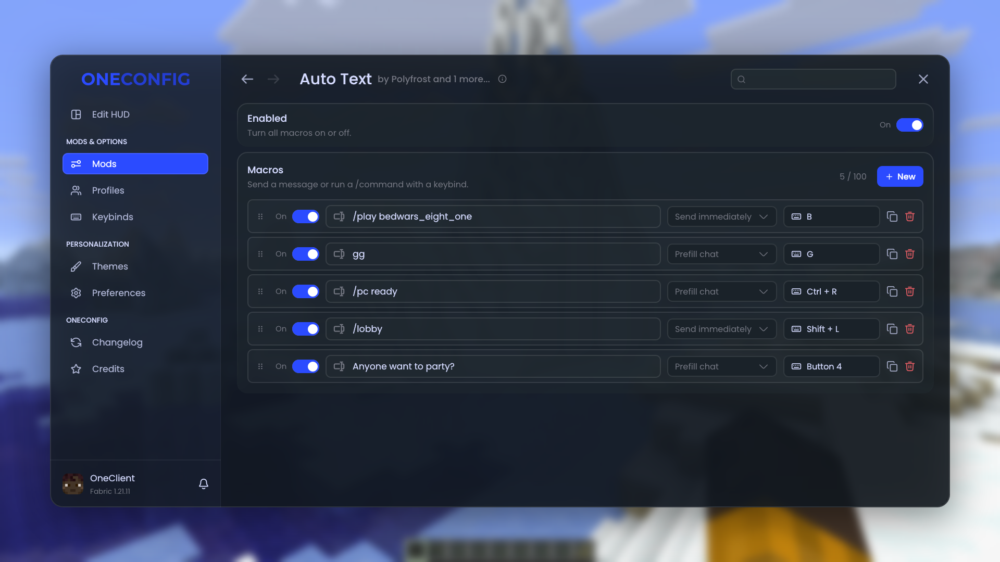

# Auto Text

Auto Text sends a saved chat message or command when you press a key. If you'd rather check the text first, it can open chat with the message already typed in.

- Up to 100 macros, each with its own keybind
- Bind a key, a combo with Ctrl, Shift or Alt, or a mouse button
- "Send immediately" or "Prefill chat" for each macro
- Turn a single macro off without deleting it, or switch them all off at once
- Drag macros to reorder them
- Duplicate a macro to make a variant of it

Macros only run in game with no screen open, and only once per press. Two macros on the same keybind won't run at all, so give each one its own.

You can use `/autotext` to open your macros.

On Hypixel, messages and chat commands like `/pc` or `/msg` only work with "Prefill chat". Other commands, such as `/play`, still send right away.

## Supported versions

- Minecraft 1.8.9 on Ornithe.
- Minecraft 1.21.1-26.3 on Fabric.

Auto Text needs [OneConfig](https://modrinth.com/mod/oneconfig).

## Support

- Report bugs and ask questions on the [Polyfrost Discord](https://polyfrost.org/discord).
- Check [Polyfrost Status](https://status.polyfrost.org/) if a Polyfrost service is down.
